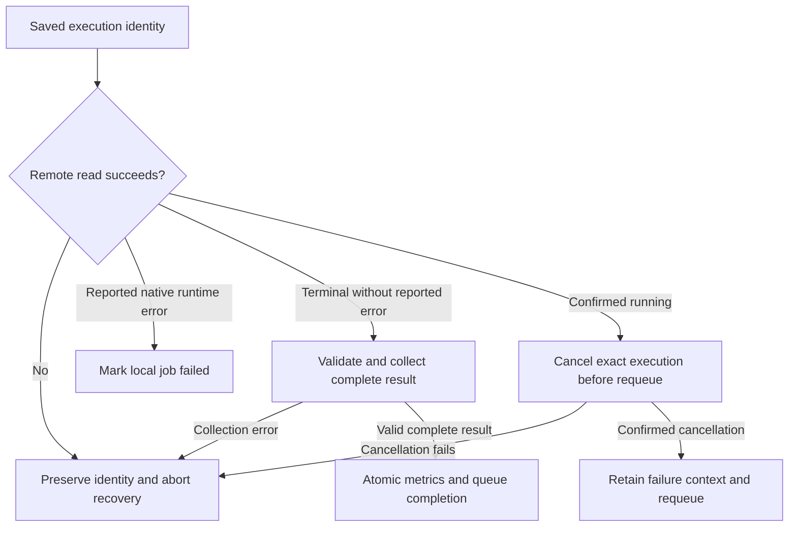

# Operations, recovery and troubleshooting

Use this guide for the configured executor, not as permission to start jobs. Local tests use temporary databases and mocked transport. Production queues, remote compute and provider acquisition have separate ownership.

## Before starting a runtime

Record the intended source/build version, data directory, queue names, dedicated pool projects and any known `(project_id, backtest_id)` pairs. Inspect existing ownership and remote state through the established operator workflow. An OS lock permits one executor per runtime directory; another instance does not kill unrelated processes. `serve` performs startup recovery, so do not use restart as a polling-error workaround.

Queueing writes local state, and an already-running server may immediately submit that work. ObjectStore and project management commands can mutate cloud resources. CLI `--help` and `--version` are safe smoke checks; `test-api` is an external account call, and live tests create remote resources.

## Recovery state machine

A reported native runtime error marks the queue row failed; a confirmed missing remote record can be requeued. A failed read is not a failed backtest. Preserve remote identity and publication evidence before diagnosing retries. Ambiguous create responses are not blindly replayed. Retry resets old execution/result fields while retaining requested project pins; it is a new execution, not a continuation of old evidence.

SIGINT/SIGTERM stop acquisition, allow up to 30 seconds for preparation and two minutes for collection, and leave unfinished work recoverable. Confirm terminal cloud state before any deliberate lifecycle changes. The source/test contracts are described in [architecture](ARCHITECTURE.md).

## Symptoms and bounded next steps

| Symptom | Inspect / action |
|---|---|
| Linker cannot find `-lduckdb` after cache restore | Run `bash scripts/bootstrap_duckdb.sh` in the build checkout, then rebuild. This only clears the dependency's build artifacts and reruns its locked setup. Registry/release download access may be needed. |
| Executable cannot load `libduckdb.so` | Keep matching DuckDB 1.5.6 in the binary's `deps` directory, or use an explicit matching loader path. Do not substitute a different library version. |
| No strategy DBs found | Check the intended data path and schema initialization; do not point tooling at another project's runtime to make discovery pass. |
| Authentication error | Check credential variable names, blank overrides and private-file permissions without printing values. Database credential fallback is unsupported. |
| Strategy retained but not scheduled | Check shared/per-DB project selection and positive scheduler weight. |
| Local timeout or API outage | Preserve cloud identity; inspect the exact remote execution. Do not infer that the account job stopped. |
| Completed flag but missing orders/fees/stats | Treat publication as incomplete until required evidence arrives. Late end-of-algorithm errors invalidate apparent success. |
| v092 missing/error/capacity/checksum receipt | Reject that planned evidence set; collect a new complete export/probe. Never relabel a later callback as pre-trigger. |
| Private/historical doc link unavailable | Check the publication boundary; public Git intentionally omits research data and runtime evidence. |

## Backup and migration

Use the shared access-lock protocol before opening mutable DuckDB files. Analytical readers should prefer immutable Parquet releases. Backups checkpoint/copy under the same lock; a raw file copy while a writer runs is not the documented procedure. Validate a backup's identity and intended scope before restoring. Keep credentials separate. See [storage/migration](DUCKDB_MIGRATION.md) for implementation and legacy rollback boundaries.

No automatic deployment, restart, cleanup, broker action or data acquisition is configured by CI. Published test success is a source-validation receipt, not current runtime readiness.
